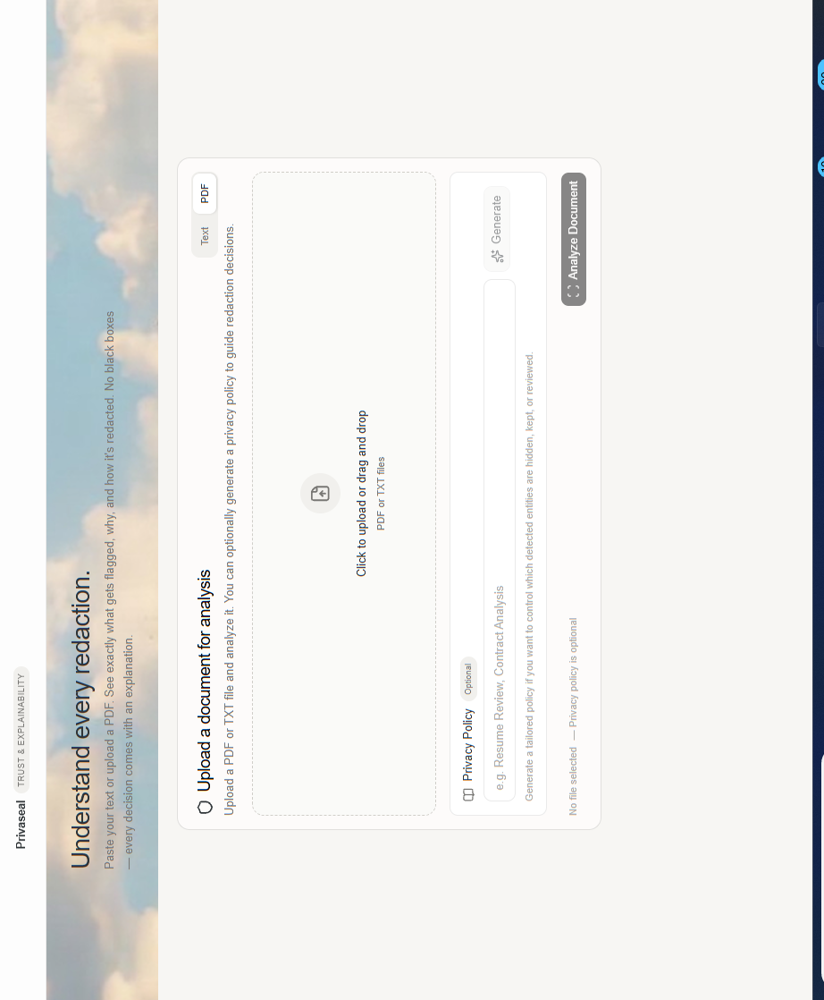
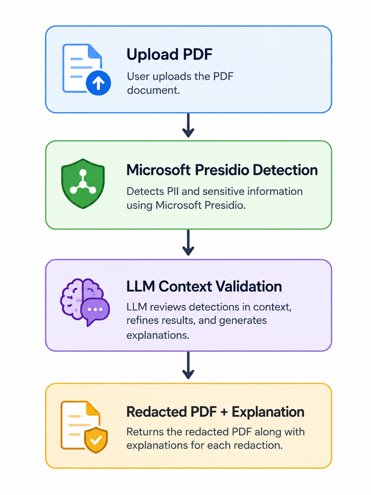
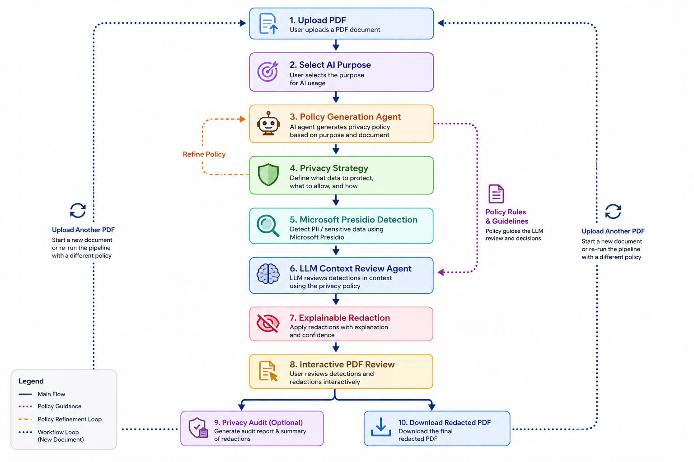
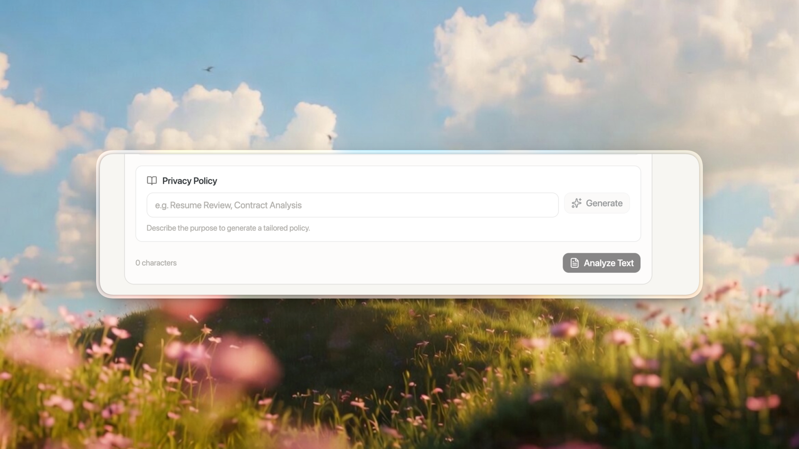
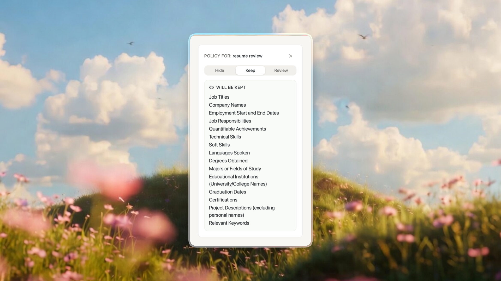
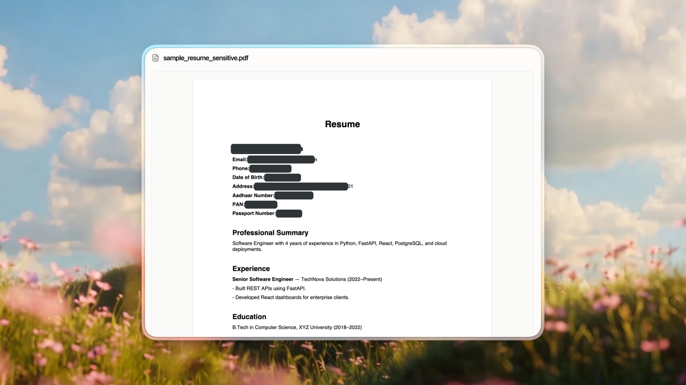
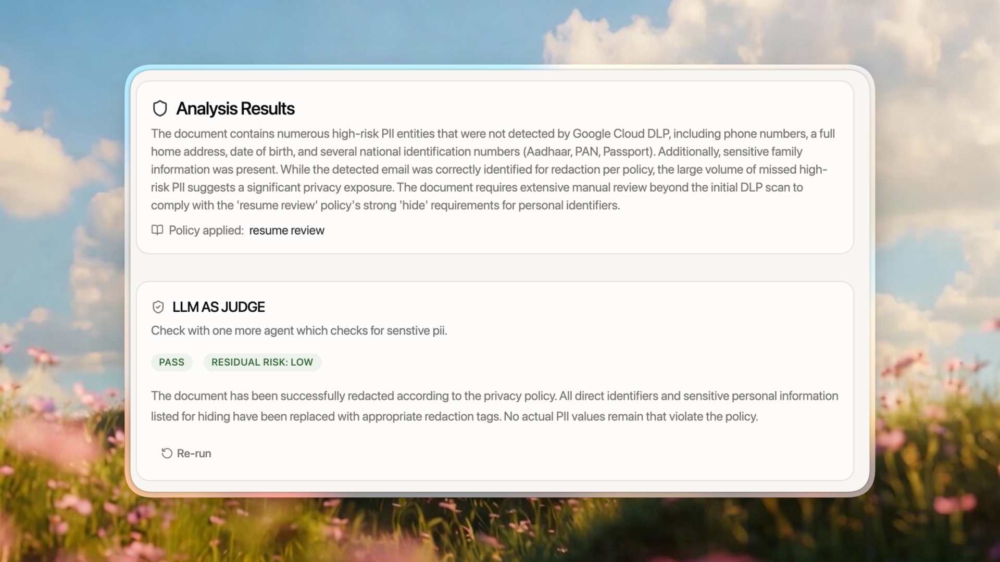

# Privaseal – Explainable AI Document Anonymization



<p align="left">
  <a href="https://www.python.org/"></a>
  <a href="https://fastapi.tiangolo.com/"></a>
  <a href="https://microsoft.github.io/presidio/"></a>
  <a href="https://pymupdf.readthedocs.io/"></a>
  <a href="https://ai.google.dev/"></a>
</p>

**Explainable, purpose-driven document privacy processing for safer AI workflows.**


---

## Overview

Privaseal is an explainable document anonymization platform designed to help users protect sensitive information before sharing documents with external AI tools.

Traditional redaction tools often behave like black boxes: they detect sensitive information and remove it without explaining why. Privaseal takes a purpose-driven approach, allowing users to define why a document is being shared and review privacy decisions before processing.

The platform combines deterministic PII detection, configurable privacy policies, optional contextual LLM review, permanent PDF redaction, and post-processing verification.

It also generates a privacy-preserving evidence report that records processing decisions and verification results without including the original document text or detected PII values.

## The Problem

Users increasingly share resumes, contracts, medical reports, financial documents, and other sensitive files with AI assistants.

Before sharing these documents, they need confidence that:

- Sensitive information has been appropriately protected.
- Relevant information has not been unnecessarily removed.
- Privacy decisions can be understood and reviewed.
- The resulting document has undergone meaningful verification.
- Processing evidence can be retained without exposing the original sensitive content.

Privaseal aims to replace blind trust with explainable, reviewable privacy decisions.

## Core Idea: Purpose-Driven Privacy

Instead of asking only:

> What information is personally identifiable?

Privaseal also considers:

> Why is this document being shared with an AI?

The intended purpose helps determine which information should be hidden, retained, or reviewed.

Example purposes include:

- Resume Review
- Contract Analysis
- Medical Analysis
- Financial Analysis
- General AI Assistant
- Custom Purpose

The privacy policy categorizes detected information into three actions:

| Action | Meaning |
|---|---|
| Hide | Remove the selected information from the output |
| Keep | Retain the information |
| Review | Flag the information for human consideration |

Users can inspect and modify the proposed policy before processing.

## Solution Architecture

### Normal Approach



### Privaseal Approach



## Architecture Components


### 1. Purpose Selection



Users specify why they intend to share a document with an AI system.

The selected purpose provides context for generating a privacy strategy rather than applying the same redaction rules to every document.

### 2. Policy Generation Agent



A Google ADK-based agent generates a suggested privacy strategy based on the selected purpose.

The strategy categorizes information into:

- Hide
- Keep
- Review

Users remain in control and can modify the suggested policy before proceeding.

### 3. PII Detection Layer

Microsoft Presidio is the primary detection engine.

The detection layer supports:

- Standard PII detection.
- Confidence scores for detected entities.
- Structured entity information.
- Custom Indian identifier recognizers.
- Deterministic detection and policy enforcement.

Custom recognizers extend detection to identifiers relevant to Indian documents, including Aadhaar, PAN, IFSC, UPI IDs, and Indian phone numbers.

### 4. Optional LLM Context Review

The LLM layer complements deterministic detection rather than replacing it.

When explicitly enabled, it can assist with:

- Identifying contextual information.
- Reviewing ambiguous entities.
- Providing additional context for privacy decisions.

**LLM-based detection review is disabled by default.** The primary detection and policy pipeline does not depend on an external LLM call.

### 5. Interactive PDF Review



The frontend renders the original PDF and allows users to inspect detected entities before exporting.

Users can:

- Review highlighted entities.
- Inspect explanations and confidence scores.
- Accept or modify privacy recommendations.
- Choose the appropriate action for detected information.

The original document remains unchanged during the review stage.

### 6. Permanent PDF Redaction

After the user confirms the decisions, the backend processes the original PDF.

The PDF processing pipeline includes:

- Native PDF text extraction.
- OCR-assisted processing for scanned documents.
- Text location and redaction mapping.
- Permanent PDF redaction annotations.
- Redaction or anonymization actions.
- Metadata and XMP metadata removal.
- Removal of attachments, annotations, form fields, links, and bookmarks.

The processed document is saved as a separate output.

### 7. PDF Verification

Privaseal performs post-processing verification on the generated PDF.

The verification layer checks for residual sensitive information across supported PDF content, including:

- Extracted text.
- OCR-extracted text.
- Metadata and XMP metadata.
- Annotations.
- Form fields.
- Bookmarks.
- Embedded files.

The export is rejected when the implemented verification checks fail.

Verification provides evidence that the implemented checks passed; it does not guarantee that every possible form of sensitive information has been removed.

### 8. Privacy Evidence Report

Privaseal can optionally package a JSON evidence report alongside the sanitized PDF.

The report records:

- Processing metadata.
- Total detected entity counts.
- Entity-type distribution.
- Policy action counts.
- PDF sanitization operations.
- Verification status.
- Individual verification check results.
- Aggregate verification findings.
- Processing limitations.

The report is designed to avoid including:

- Original document text.
- Detected PII values.
- Raw verification findings.
- Sensitive document metadata.

When enabled, the user receives a ZIP containing:

```text
privaseal_export.zip
│
├── redacted_document.pdf
│
└── privacy_evidence_report.json
```

This provides an auditable record of the processing performed without reproducing the sensitive information being protected.

### 9. Optional Privacy Audit



Privaseal also provides an optional privacy audit workflow.

The audit can independently review the processed content and report potential residual privacy risks.

It acts as an additional review mechanism and does not modify the document.


## Application Preview

### Document Analysis Dashboard


## Design Principles

- **Purpose-driven privacy:** Decisions consider the intended use of a document.
- **Explainability:** Users can understand detected entities and privacy recommendations.
- **Human-in-the-loop:** Users retain control over privacy decisions.
- **Deterministic enforcement:** Policy actions are applied through explicit backend rules.
- **Privacy-preserving evidence:** Reports contain aggregate processing information rather than raw PII.
- **Document integrity:** Original files are preserved during review and processed into separate outputs.
- **Verification:** Processed PDFs undergo post-processing checks.

## Current Features

- PDF and text processing.
- Purpose selection.
- AI-assisted privacy policy generation.
- Editable Hide / Keep / Review policies.
- Microsoft Presidio integration.
- Custom Indian PII recognizers.
- Optional LLM contextual review.
- Interactive PDF review.
- Explainable entity detection.
- Permanent PDF redaction.
- OCR-assisted scanned PDF processing.
- PDF metadata and embedded-content sanitization.
- Post-redaction verification.
- Optional JSON privacy evidence report.
- ZIP export containing the sanitized PDF and evidence report.
- Optional privacy audit.
- Automated backend regression tests.

## Technology Stack

### Frontend

- Next.js
- React
- Tailwind CSS
- React PDF
- PDF.js

### Backend

- Python
- FastAPI
- Microsoft Presidio
- spaCy
- Google ADK
- Gemini
- PyMuPDF
- Tesseract OCR

### Testing and Evaluation

- pytest
- Custom PII test datasets
- Detection evaluation metrics
- PDF sanitization tests
- PDF verification tests
- Policy enforcement tests
- Evidence report security tests

## Backend Project Structure

```text
backend/
│
├── agents/
│   ├── pii_explainer/
│   ├── policy_generator/
│   └── privacy_auditor/
│
├── common/
│   └── config/
│
├── evaluation/
│   ├── dataset.py
│   ├── evaluator.py
│   ├── metrics.py
│   └── run_evaluation.py
│
├── evaluation_data/
│   ├── pii_test_cases.json
│   └── latest_evaluation_report.json
│
├── pii/
│   ├── analyzer.py
│   ├── anonymizer.py
│   ├── evidence_report.py
│   ├── india_recognizers.py
│   ├── pdf_ocr.py
│   ├── pdf_sanitizer.py
│   └── pdf_verifier.py
│
├── test_agent/
│
├── main.py
├── pii_route.py
├── requirements.txt
│
└── test_*.py
```

### Running the Backend Locally

### Prerequisites

Make sure the following are installed:

- Python 3.10 or later (confirm against the project's actual dependency compatibility before choosing a production version).
- pip
- Tesseract OCR
- Git

### 1. Clone the repository

```bash
git clone <your-repository-url>
cd PII-Sanitization/backend
```

### 2. Create a virtual environment

```powershell
python -m venv venv
```

Activate it on Windows:

```powershell
.\venv\Scripts\Activate.ps1
```

### 3. Install Python dependencies

```powershell
python -m pip install --upgrade pip
pip install -r requirements.txt
```

### 4. Install Tesseract OCR

Install Tesseract OCR separately for your operating system.

Ensure that the Tesseract executable is accessible to the backend. Scanned PDF OCR functionality depends on this installation.

### 5. Configure environment variables

The backend loads environment configuration from:

- Project-root `.env`
- Backend `.env`

Create the required environment variables based on the project's configuration.

The following variable is used to configure allowed frontend origins:

```env
FRONTEND_ORIGINS=http://localhost:3000,http://127.0.0.1:3000
```

For deployment, replace these local origins with the actual frontend origin.

Google credentials can be configured using:

```env
GOOGLE_APPLICATION_CREDENTIALS=path/to/service-account.json
```

Relative credential paths are resolved from the project root.

Never commit `.env` files, service-account JSON files, or API credentials to GitHub.

### 6. Start the backend

From the backend directory:

```powershell
uvicorn main:app --reload
```

The backend runs locally at:

```text
http://127.0.0.1:8000
```

### 7. Explore the API

FastAPI interactive documentation:

```text
http://127.0.0.1:8000/docs
```

Health check:

```text
http://127.0.0.1:8000/health
```

Root endpoint:

```text
http://127.0.0.1:8000/
```

### Running Tests

Run the complete backend test suite:

```powershell
pytest -v
```

Run individual test modules:

```powershell
pytest test_evidence_report.py -v
pytest test_pdf_api.py -v
pytest test_pdf_verifier.py -v
pytest test_policy_enforcement.py -v
```

The test suite covers PII detection, policy enforcement, PDF processing, OCR, sanitization, verification, and privacy evidence report generation.
### 4. Configure environment variables

Create a `.env` file using the environment variables required by the project configuration.

Do not commit API keys, credentials, or other secrets to version control.

### 5. Install and configure Tesseract OCR

Install Tesseract OCR for your operating system and ensure that the executable is available to the backend.

OCR functionality depends on a working Tesseract installation.

### 6. Start the backend

From the backend directory, run:

```bash
uvicorn main:app --reload
```

The API should be available at:

```text
http://127.0.0.1:8000
```

If enabled in the application, interactive API documentation is available at:

```text
http://127.0.0.1:8000/docs
```

## Running Tests

From the backend directory:

```bash
pytest -v
```

To run a specific test module:

```bash
pytest test_evidence_report.py -v
pytest test_pdf_api.py -v
pytest test_pdf_verifier.py -v
pytest test_policy_enforcement.py -v
```

The test suite covers detection, policy enforcement, PDF processing, OCR, sanitization, verification, and evidence report generation.

## Privacy and Security Considerations

Privaseal is designed to reduce the exposure of sensitive information during document processing.

Important considerations:

- Uploaded documents should be handled as sensitive data.
- API credentials must be stored securely.
- LLM-based review is optional and disabled by default.
- Evidence reports intentionally exclude raw PII and original document text.
- Verification checks cover supported PDF content structures, not every conceivable information channel.
- Users should review the final document before sharing it externally.

**DPDP positioning:** The privacy evidence report provides processing records and verification information that may support privacy governance workflows. It does not, by itself, establish compliance with the Digital Personal Data Protection Act, 2023 or any other legal framework.

## Why Privaseal?

Most anonymization tools answer:

> What sensitive information did we find?

Privaseal aims to answer a more useful question:

> Given what you're trying to do with this document, what should be protected, what should remain visible, and why?

By combining purpose-aware privacy policies, deterministic PII detection, optional contextual AI review, permanent PDF sanitization, verification, and privacy-preserving evidence reports, Privaseal aims to make document anonymization more transparent and reviewable.

---

**Privaseal — Privacy decisions you can understand and verify.**