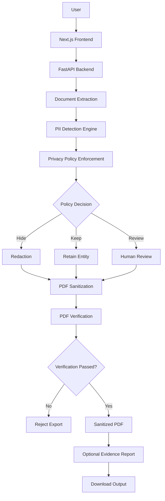

# Privaseal – System Architecture

## 1. Introduction

Privaseal is a purpose-driven document anonymization platform designed to protect sensitive information before documents are shared with external AI systems.

The system combines deterministic PII detection, configurable privacy policies, optional LLM-assisted review, PDF sanitization, post-processing verification, and privacy-preserving evidence generation.

The architecture follows a modular design that separates:

- Frontend interaction and document review.
- Backend API and request handling.
- PII detection and policy enforcement.
- PDF processing and sanitization.
- Verification and evidence generation.

## 2. High-Level Architecture



## 3. Major Components

### 3.1 Frontend Layer

**Technology:** Next.js, React, Tailwind CSS, React PDF, PDF.js.

Responsibilities:

- Accept PDF and text uploads.
- Allow users to select a processing purpose.
- Display detected PII entities.
- Present privacy policy recommendations.
- Allow users to review and modify entity decisions.
- Display analysis results and explanations.
- Trigger PDF export and optional privacy auditing.
- Download processed documents and evidence reports.

The frontend communicates with the FastAPI backend through API requests.

### 3.2 API Layer

**Technology:** FastAPI.

Main entry point: `main.py`

The application initializes:

- Environment configuration.
- CORS middleware.
- FastAPI application metadata.
- PII processing routes.

The PII router is registered under:

```text
/pii
```

The API also exposes:

| Endpoint | Purpose |
|---|---|
| `/` | Application information and status |
| `/health` | Backend health check |
| `/docs` | Interactive API documentation |

Detailed endpoint specifications are maintained separately in `API.md`.

### 3.3 Document Processing Layer

**Technology:** PyMuPDF and Tesseract OCR.

The document processing layer extracts information from uploaded documents.

Responsibilities:

- Process PDF files.
- Extract native PDF text.
- Use OCR for scanned document content.
- Identify text locations within PDF pages.
- Map detected entities to document coordinates.

Native text extraction and OCR-assisted extraction support different PDF formats.

### 3.4 PII Detection Layer

**Technology:** Microsoft Presidio and spaCy.

Primary implementation:

```text
pii/analyzer.py
pii/india_recognizers.py
```

The detection engine identifies sensitive entities and produces structured detection results.

Supported detection includes standard PII categories and custom Indian identifiers, such as:

- Aadhaar
- PAN
- Indian phone numbers
- IFSC codes
- UPI IDs
- Email addresses
- Person names and other supported entity types

Each detection can contain:

- Entity type.
- Character start and end positions.
- Confidence score.
- Detected value.
- Explanation.
- Risk classification.
- Recommendation.
- Detection source.

### 3.5 Privacy Policy Enforcement

The privacy policy determines what happens to detected entities.

The policy supports three actions:

| Action | Description |
|---|---|
| Hide | Redact the detected entity |
| Keep | Preserve the detected entity |
| Review | Flag the entity for human consideration |

Policy enforcement is handled deterministically by the backend.

The implementation includes canonical entity mapping and policy aliases so that different names for supported entity types can be normalized.

When conflicting policy actions exist, the current precedence is:

```text
Hide > Review > Keep
```

Entities without an explicit policy decision default to redaction.

The policy pipeline separates detection from the decision to redact, allowing privacy decisions to be applied consistently.

### 3.6 Optional LLM Review

**Technology:** Google ADK and Gemini.

Privaseal includes an optional LLM-assisted contextual review layer.

Its purpose is to complement deterministic detection by reviewing contextual information and providing additional explanations.

The LLM review mechanism is disabled by default.

The core deterministic detection and policy enforcement pipeline remains available without requiring an external LLM review call.

### 3.7 PDF Sanitization Layer

Primary implementation:

```text
pii/pdf_sanitizer.py
```

PDF sanitization is responsible for removing potentially sensitive information and document structures beyond visible text.

The processing pipeline includes:

- Applying permanent PDF redactions.
- Removing document metadata.
- Clearing XMP metadata.
- Removing attachments.
- Removing annotations.
- Removing form fields.
- Removing links.
- Removing bookmarks.
- Saving the sanitized PDF with cleanup and garbage collection.

For anonymization actions, replacement text can be used instead of a black redaction area.

The original uploaded document is not modified during the review stage. Processing produces a separate output document.

### 3.8 PDF Verification Layer

Primary implementation:

```text
pii/pdf_verifier.py
```

After sanitization, the generated PDF undergoes post-processing verification.

The verifier checks supported PDF content structures for residual sensitive information.

Checks include:

- Extracted text.
- OCR-extracted text.
- Metadata.
- XMP metadata.
- Annotations.
- Form fields.
- Bookmarks.
- Embedded files.

The verification result contains:

- Overall verification status.
- Individual check results.
- Failed checks.
- Aggregate finding information.

The export endpoint rejects the generated document when verification fails.

**Important:** Successful verification means the implemented checks passed. It is not a mathematical guarantee that every possible form of sensitive information has been removed.

### 3.9 Privacy Evidence Report

Primary implementation:

```text
pii/evidence_report.py
```

Privaseal can optionally generate a JSON evidence report alongside the sanitized PDF.

The report records:

- Processing metadata.
- Total detected entity count.
- Entity-type distribution.
- Policy action counts.
- PDF sanitization operations.
- Verification status.
- Individual verification check results.
- Aggregate finding count.
- Processing limitations.

The evidence report is designed to exclude:

- Original document text.
- Raw detected PII values.
- Raw verification findings.
- Sensitive document metadata.

When requested, the backend packages the sanitized PDF and JSON report into a ZIP archive.

```text
privaseal_export.zip
│
├── redacted_document.pdf
│
└── privacy_evidence_report.json
```

This provides a privacy-preserving record of the processing performed.

## 4. Backend Module Organization

```text
backend/
│
├── agents/
│   ├── pii_explainer/
│   ├── policy_generator/
│   └── privacy_auditor/
│
├── common/
│   └── config/
│       ├── adk.py
│       └── env.py
│
├── evaluation/
│   ├── dataset.py
│   ├── evaluator.py
│   ├── metrics.py
│   └── run_evaluation.py
│
├── evaluation_data/
│   ├── pii_test_cases.json
│   └── latest_evaluation_report.json
│
├── pii/
│   ├── analyzer.py
│   ├── anonymizer.py
│   ├── evidence_report.py
│   ├── india_recognizers.py
│   ├── pdf_ocr.py
│   ├── pdf_sanitizer.py
│   └── pdf_verifier.py
│
├── services/
├── test_agent/
│
├── main.py
├── pii_route.py
└── requirements.txt
```

## 5. End-to-End Processing Flow

### Step 1: Document Upload

The user uploads a PDF or text document through the frontend.

The backend validates the uploaded file before processing.

### Step 2: Text Extraction

The backend extracts document text using native PDF extraction or OCR-assisted processing where required.

### Step 3: PII Detection

The detection engine identifies supported sensitive entities and generates structured detection results.

### Step 4: Privacy Policy Application

The backend applies the selected privacy policy to each detected entity.

Each entity receives a corresponding action:

- Hide
- Keep
- Review

### Step 5: User Review

The frontend presents detected entities and their associated decisions for user inspection.

Users can modify decisions before export.

### Step 6: PDF Sanitization

The backend applies the confirmed redaction or anonymization decisions to the original PDF.

It also removes supported metadata and embedded document structures.

### Step 7: Verification

The generated PDF is checked for residual sensitive information across supported content structures.

If verification fails, the export is rejected.

### Step 8: Evidence Generation

If requested, the backend generates a privacy-preserving JSON evidence report.

### Step 9: Export

The user downloads either:

- The sanitized PDF.
- A ZIP archive containing the sanitized PDF and evidence report.

## 6. Security and Privacy Design

Privaseal follows several security-oriented design principles:

1. **Input validation:** Uploaded files are validated before processing.
2. **Size restrictions:** PDF uploads have a configurable size limit.
3. **Controlled CORS:** Frontend origins are configured through environment variables.
4. **Deterministic enforcement:** Privacy policy actions are applied through explicit backend rules.
5. **Optional external AI processing:** LLM review is disabled by default.
6. **Metadata sanitization:** Supported metadata and document structures are removed.
7. **Post-processing verification:** Generated PDFs undergo verification before export.
8. **Privacy-preserving evidence:** Evidence reports exclude raw PII and original document text.

## 7. Design Limitations

The architecture provides multiple layers of privacy protection, but it has limitations:

- Detection accuracy depends on the supported recognizers and document quality.
- OCR results depend on image quality and OCR configuration.
- Verification covers implemented PDF content checks, not every possible information channel.
- Contextual LLM review is optional and is not a substitute for deterministic validation.
- Users should inspect the final document before sharing it externally.

The evidence report provides processing information that may support privacy governance workflows. It does not independently establish compliance with the Digital Personal Data Protection Act, 2023.

## 8. Future Architecture Considerations

Potential improvements can be considered after the current implementation and deployment work is complete:

- Expanded document format support.
- More comprehensive verification strategies.
- Improved detection evaluation datasets.
- Additional audit logging controls.
- Production-grade file lifecycle and retention management.

These are future considerations, not claims about currently implemented functionality.

---

**Privaseal — Explainable privacy decisions for safer document sharing.**